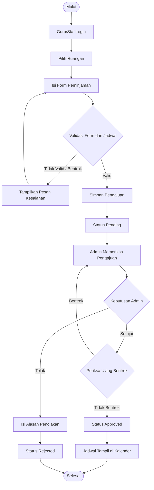
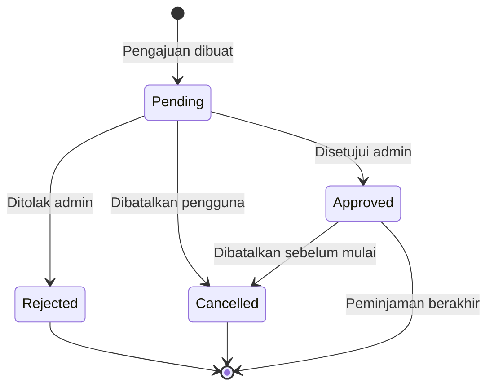
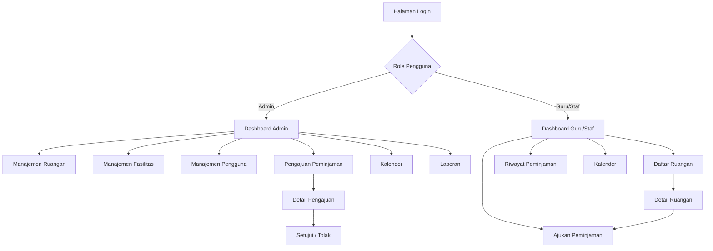
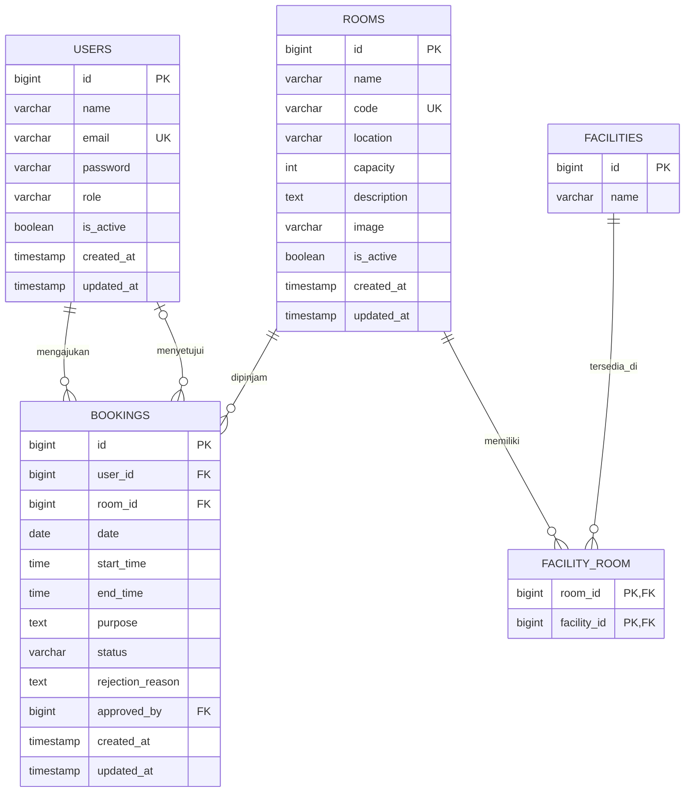

# SOFTWARE REQUIREMENTS SPECIFICATION (SRS)
## SISTEM INFORMASI PEMINJAMAN RUANGAN BERBASIS WEB

**Dokumen Spesifikasi Kebutuhan Perangkat Lunak**

| Informasi | Keterangan |
|---|---|
| Nama Proyek | Sistem Informasi Peminjaman Ruangan |
| Jenis Aplikasi | Aplikasi Berbasis Web |
| Framework | Laravel dan Livewire |
| Database | MySQL |
| Durasi Pengerjaan | 1 Bulan (20 Hari Kerja) |
| Pengembang | Siswa Magang |
| Versi Dokumen | 1.0 |

---

# BAB I. PENDAHULUAN

## 1.1 Latar Belakang

Ruangan merupakan salah satu fasilitas penting dalam kegiatan sekolah. Ruangan seperti laboratorium komputer, ruang rapat, aula, dan ruang multimedia sering digunakan untuk berbagai kegiatan.

Dalam pelaksanaannya, peminjaman ruangan terkadang masih dilakukan secara manual. Guru atau staf harus menghubungi petugas untuk menanyakan ketersediaan ruangan. Cara ini dapat menyebabkan beberapa permasalahan, seperti jadwal peminjaman yang bertabrakan, kesulitan mengetahui ruangan yang tersedia, dan pencatatan peminjaman yang kurang terorganisir.

Untuk mengatasi permasalahan tersebut, diperlukan sebuah **Sistem Informasi Peminjaman Ruangan Berbasis Web**.

Sistem ini memungkinkan guru atau staf mengajukan peminjaman secara online, sedangkan admin dapat mengelola data ruangan, memeriksa pengajuan, serta mengatur jadwal peminjaman melalui satu aplikasi.

## 1.2 Tujuan Pengembangan

Tujuan pengembangan sistem ini adalah:

1. Mempermudah guru dan staf dalam mengajukan peminjaman ruangan.
2. Menyediakan informasi mengenai ruangan dan jadwal penggunaannya.
3. Membantu admin mengelola data ruangan dan permohonan peminjaman.
4. Menghindari penggunaan ruangan pada jadwal yang bertabrakan.
5. Menyediakan riwayat dan laporan peminjaman ruangan.
6. Membuat proses peminjaman lebih teratur dan terdokumentasi.

## 1.3 Ruang Lingkup Sistem

Sistem yang dikembangkan memiliki ruang lingkup sebagai berikut:

- Sistem berbasis web dan dapat diakses menggunakan browser.
- Memiliki dua jenis pengguna, yaitu Admin dan Guru/Staf.
- Admin mengelola data ruangan, fasilitas, pengguna, dan pengajuan peminjaman.
- Guru/Staf dapat melihat informasi ruangan dan mengajukan peminjaman.
- Sistem memeriksa bentrok jadwal peminjaman.
- Sistem menyediakan kalender peminjaman dan laporan.
- Sistem tidak mencakup pembayaran, notifikasi WhatsApp, atau aplikasi mobile.

---

# BAB II. GAMBARAN UMUM SISTEM

## 2.1 Deskripsi Sistem

Sistem Informasi Peminjaman Ruangan merupakan aplikasi yang digunakan untuk mengelola proses peminjaman ruangan di lingkungan sekolah.

Setiap pengguna harus login menggunakan akun yang telah terdaftar.

Guru atau staf dapat memilih ruangan, menentukan tanggal dan jam peminjaman, kemudian mengirimkan pengajuan.

Pengajuan akan diterima oleh admin untuk diperiksa. Admin dapat menyetujui atau menolak pengajuan tersebut.

Apabila pengajuan disetujui, jadwal peminjaman akan tercatat pada kalender dan ruangan dianggap telah dipesan untuk waktu tersebut.

## 2.2 Jenis Pengguna

Sistem memiliki dua jenis pengguna.

| Pengguna | Deskripsi |
|---|---|
| Admin | Pengguna yang bertugas mengelola ruangan, pengguna, peminjaman, dan laporan |
| Guru/Staf | Pengguna yang dapat melihat ruangan, mengajukan peminjaman, dan melihat riwayat peminjaman |

## 2.3 Hak Akses Pengguna

| Fitur | Admin | Guru/Staf |
|---|:---:|:---:|
| Login dan Logout | ✓ | ✓ |
| Melihat Dashboard | ✓ | ✓ |
| Mengelola Data Ruangan | ✓ | — |
| Mengelola Fasilitas | ✓ | — |
| Mengelola Pengguna | ✓ | — |
| Melihat Daftar Ruangan | ✓ | ✓ |
| Mengajukan Peminjaman | — | ✓ |
| Menyetujui/Menolak Peminjaman | ✓ | — |
| Membatalkan Peminjaman Pribadi | — | ✓ |
| Melihat Kalender Peminjaman | ✓ | ✓ |
| Melihat Semua Riwayat Peminjaman | ✓ | — |
| Melihat Riwayat Pribadi | — | ✓ |
| Mengunduh Laporan | ✓ | — |

## 2.4 Alur Proses Peminjaman

Alur peminjaman ruangan dimulai ketika Guru/Staf mengajukan peminjaman dan berakhir ketika pengajuan disetujui atau ditolak oleh Admin.

**Keterangan:**

1. Guru/Staf harus login sebelum mengajukan peminjaman.
2. Pengguna memilih ruangan dan mengisi formulir peminjaman.
3. Sistem memvalidasi data dan memeriksa jadwal.
4. Jika pengajuan valid, sistem menyimpannya dengan status Pending.
5. Admin memeriksa pengajuan.
6. Admin dapat menyetujui atau menolak pengajuan.
7. Jika disetujui, jadwal akan tercatat sebagai peminjaman aktif pada kalender.
8. Jika ditolak, pengguna dapat melihat alasan penolakan.

---

# BAB III. KEBUTUHAN FUNGSIONAL

Kebutuhan fungsional menjelaskan fitur dan fungsi yang harus tersedia dalam aplikasi.

Setiap kebutuhan diberikan kode **FR (Functional Requirement)** agar memudahkan proses pengembangan dan pengujian.

## 3.1 Autentikasi Pengguna

### FR-01 — Login

Sistem harus menyediakan halaman login.

**Ketentuan:**

- Pengguna login menggunakan email dan password.
- Sistem memeriksa kesesuaian akun.
- Setelah login berhasil, pengguna diarahkan ke dashboard sesuai hak aksesnya.
- Jika email atau password salah, sistem menampilkan pesan kesalahan.

### FR-02 — Logout

Pengguna dapat keluar dari aplikasi menggunakan tombol Logout.

Setelah logout, pengguna harus login kembali untuk mengakses halaman yang memerlukan autentikasi.

## 3.2 Dashboard

### FR-03 — Dashboard Admin

Sistem menampilkan informasi berikut kepada admin:

- Total ruangan.
- Jumlah pengajuan menunggu persetujuan.
- Jumlah peminjaman yang disetujui untuk hari ini.
- Jumlah peminjaman yang ditolak.
- Daftar pengajuan terbaru.

### FR-04 — Dashboard Guru/Staf

Sistem menampilkan informasi berikut kepada Guru/Staf:

- Jumlah pengajuan pribadi.
- Jumlah pengajuan yang menunggu persetujuan.
- Jumlah pengajuan yang disetujui.
- Daftar peminjaman terbaru milik pengguna.

## 3.3 Manajemen Ruangan

### FR-05 — Menambah Data Ruangan

Admin dapat menambahkan data ruangan.

Data yang diperlukan:

| Nama Field | Keterangan | Wajib |
|---|---|:---:|
| Nama Ruangan | Nama ruangan yang tersedia | Ya |
| Kode Ruangan | Kode unik untuk setiap ruangan | Ya |
| Lokasi | Lokasi atau letak ruangan | Ya |
| Kapasitas | Jumlah maksimal orang | Ya |
| Deskripsi | Informasi tambahan ruangan | Tidak |
| Fasilitas | Fasilitas yang tersedia | Tidak |
| Foto | Gambar ruangan | Tidak |
| Status | Aktif atau Tidak Aktif | Ya |

### FR-06 — Mengubah Data Ruangan

Admin dapat memperbarui informasi ruangan yang telah tersimpan.

### FR-07 — Menghapus Data Ruangan

Admin dapat menghapus ruangan yang belum memiliki riwayat peminjaman.

Ruangan yang sudah memiliki riwayat peminjaman tidak boleh dihapus, tetapi dapat dinonaktifkan agar tidak dapat dipinjam kembali.

### FR-08 — Melihat dan Mencari Ruangan

Sistem menampilkan daftar ruangan.

Pengguna dapat melakukan pencarian berdasarkan nama ruangan dan memfilter berdasarkan status ketersediaan untuk tanggal dan waktu yang dipilih.

## 3.4 Manajemen Fasilitas

### FR-09 — Mengelola Fasilitas

Admin dapat menambah, mengubah, dan menghapus data fasilitas.

Contoh data fasilitas:

- Proyektor
- AC
- Komputer
- Sound System
- Papan Tulis
- Wi-Fi

Satu ruangan dapat memiliki lebih dari satu fasilitas, dan satu fasilitas dapat digunakan oleh beberapa ruangan.

## 3.5 Manajemen Pengguna

### FR-10 — Mengelola Pengguna

Admin dapat menambah, mengubah, dan menonaktifkan akun pengguna.

Informasi pengguna meliputi:

| Field | Keterangan |
|---|---|
| Nama | Nama lengkap |
| Email | Digunakan untuk login, harus unik |
| Password | Kata sandi pengguna |
| Role | Admin atau Guru/Staf |
| Status | Aktif atau Tidak Aktif |

Password harus disimpan dalam bentuk hash, bukan teks biasa.

## 3.6 Peminjaman Ruangan

### FR-11 — Mengajukan Peminjaman

Guru/Staf dapat mengajukan peminjaman melalui formulir yang berisi:

| Field | Keterangan |
|---|---|
| Ruangan | Ruangan yang ingin dipinjam |
| Tanggal | Tanggal penggunaan ruangan |
| Jam Mulai | Waktu mulai peminjaman |
| Jam Selesai | Waktu selesai peminjaman |
| Keperluan | Tujuan penggunaan ruangan |

**Ketentuan:**

- Seluruh field wajib diisi.
- Tanggal peminjaman tidak boleh berada di masa lalu.
- Jam selesai harus lebih besar dari jam mulai.
- Ruangan harus berstatus aktif.
- Setelah pengajuan berhasil, status awal peminjaman adalah **Menunggu Persetujuan (Pending)**.

### FR-12 — Pemeriksaan Bentrok Jadwal

Sistem harus memeriksa apakah jadwal peminjaman bertabrakan dengan peminjaman lain yang sudah disetujui.

Contoh:

| Ruangan | Jadwal | Kondisi |
|---|---|---|
| Lab Komputer 1 | 08.00–10.00 | Sudah dipesan |
| Lab Komputer 1 | 09.00–11.00 | Bentrok |
| Lab Komputer 1 | 10.00–12.00 | Tidak bentrok |
| Lab Komputer 2 | 09.00–11.00 | Tidak bentrok |

Jika jadwal bertabrakan, sistem menampilkan pesan bahwa ruangan tidak tersedia pada waktu tersebut.

Pengajuan yang masih Pending tidak dianggap sebagai jadwal yang sudah dipesan. Namun, saat admin akan menyetujui pengajuan, sistem harus memeriksa ulang bentrok jadwal.

### FR-13 — Melihat Status Peminjaman

Guru/Staf dapat melihat status setiap pengajuan.

| Status | Keterangan |
|---|---|
| Pending | Pengajuan menunggu pemeriksaan admin |
| Approved | Pengajuan telah disetujui admin |
| Rejected | Pengajuan ditolak admin |
| Cancelled | Pengajuan dibatalkan pengguna |

### FR-14 — Membatalkan Peminjaman

Guru/Staf dapat membatalkan pengajuan miliknya sendiri apabila waktu peminjaman belum dimulai dan statusnya Pending atau Approved.

Peminjaman yang dibatalkan tidak boleh diubah kembali menjadi Approved.

## 3.7 Persetujuan Peminjaman

### FR-15 — Menyetujui Peminjaman

Admin dapat menyetujui pengajuan yang berstatus Pending.

Sebelum persetujuan disimpan, sistem harus memastikan tidak terdapat peminjaman berstatus Approved dengan ruangan dan waktu yang bertabrakan.

Setelah disetujui, status berubah menjadi Approved.

### FR-16 — Menolak Peminjaman

Admin dapat menolak permohonan yang berstatus Pending.

Ketika menolak pengajuan, admin wajib memasukkan alasan penolakan.

Alasan penolakan dapat dilihat oleh Guru/Staf yang melakukan pengajuan.

## 3.8 Kalender Peminjaman

### FR-17 — Melihat Kalender

Sistem menampilkan jadwal peminjaman menggunakan tampilan kalender.

Kalender harus dapat:

- Menampilkan jadwal berdasarkan tanggal.
- Menampilkan nama ruangan dan waktu peminjaman.
- Menampilkan peminjaman yang telah disetujui.
- Memfilter jadwal berdasarkan ruangan.
- Menampilkan detail peminjaman ketika jadwal dipilih.

## 3.9 Laporan Peminjaman

### FR-18 — Laporan

Admin dapat melihat laporan peminjaman ruangan.

Laporan dapat difilter berdasarkan:

- Rentang tanggal.
- Nama ruangan.
- Status peminjaman.

Informasi laporan meliputi nama peminjam, nama ruangan, tanggal, jam mulai, jam selesai, keperluan, dan status.

### FR-19 — Export PDF

Admin dapat mengunduh laporan peminjaman dalam format PDF berdasarkan filter yang dipilih.

---

# BAB IV. ATURAN BISNIS

Aturan bisnis merupakan ketentuan yang harus dipenuhi agar proses peminjaman berjalan dengan benar.

| Kode | Aturan |
|---|---|
| BR-01 | Hanya pengguna yang telah login yang dapat menggunakan fitur peminjaman. |
| BR-02 | Hanya Admin yang dapat mengelola data master dan menyetujui peminjaman. |
| BR-03 | Ruangan Tidak Aktif tidak dapat dipinjam. |
| BR-04 | Tanggal peminjaman tidak boleh berada di masa lalu. |
| BR-05 | Jam selesai harus lebih besar daripada jam mulai. |
| BR-06 | Dua peminjaman berstatus Approved tidak boleh memiliki jadwal bertabrakan pada ruangan yang sama. |
| BR-07 | Pengajuan baru otomatis berstatus Pending. |
| BR-08 | Hanya pengajuan Pending yang dapat disetujui atau ditolak admin. |
| BR-09 | Guru/Staf hanya dapat membatalkan peminjaman miliknya sendiri sebelum waktu peminjaman dimulai. |
| BR-10 | Setiap penolakan wajib memiliki alasan. |
| BR-11 | Pengguna tidak boleh mengakses atau mengubah data yang berada di luar hak aksesnya. |
| BR-12 | Peminjaman dilakukan untuk satu tanggal dengan jam mulai dan selesai pada hari yang sama. |

## 4.1 Diagram Status Peminjaman

Berikut perubahan status yang diperbolehkan dalam sistem:

**Catatan:** Status Approved tetap tercatat setelah waktu peminjaman berakhir sebagai riwayat peminjaman. Diagram menggunakan akhir proses untuk menunjukkan bahwa tidak ada perubahan status lanjutan.

---

# BAB V. KEBUTUHAN NONFUNGSIONAL

Kebutuhan nonfungsional menjelaskan kualitas aplikasi yang diharapkan.

| Kode | Kebutuhan | Deskripsi |
|---|---|---|
| NFR-01 | Kemudahan Penggunaan | Tampilan sederhana, rapi, dan mudah dipahami. |
| NFR-02 | Responsif | Aplikasi dapat digunakan pada komputer dan smartphone. |
| NFR-03 | Keamanan | Halaman dilindungi autentikasi dan hak akses. |
| NFR-04 | Validasi | Formulir wajib memiliki validasi dan pesan kesalahan yang jelas. |
| NFR-05 | Konsistensi Data | Data peminjaman harus tersimpan dengan benar dan mencegah jadwal Approved bertabrakan, termasuk jika dua admin memproses bersamaan. |
| NFR-06 | Kemudahan Pemeliharaan | Kode disusun rapi menggunakan struktur Laravel. |
| NFR-07 | Kompatibilitas | Aplikasi berjalan pada browser modern seperti Chrome, Edge, dan Firefox. |

---

# BAB VI. RANCANGAN ANTARMUKA

Aplikasi minimal memiliki halaman berikut.

## 6.1 Halaman Umum

| Halaman | Fungsi |
|---|---|
| Login | Masuk ke sistem |
| Dashboard | Menampilkan informasi ringkas |
| Profil | Melihat informasi akun pengguna |

## 6.2 Halaman Admin

| Halaman | Fungsi |
|---|---|
| Dashboard Admin | Melihat statistik dan pengajuan terbaru |
| Manajemen Ruangan | CRUD data ruangan |
| Manajemen Fasilitas | CRUD data fasilitas |
| Manajemen Pengguna | Mengelola akun pengguna |
| Daftar Pengajuan | Melihat semua pengajuan peminjaman |
| Detail Pengajuan | Menyetujui atau menolak peminjaman |
| Kalender | Melihat jadwal peminjaman |
| Laporan | Melihat, memfilter, dan mencetak laporan |

## 6.3 Halaman Guru/Staf

| Halaman | Fungsi |
|---|---|
| Dashboard | Menampilkan ringkasan peminjaman pribadi |
| Daftar Ruangan | Melihat dan mencari ruangan |
| Detail Ruangan | Melihat fasilitas dan informasi ruangan |
| Form Peminjaman | Mengajukan peminjaman |
| Riwayat Peminjaman | Melihat status dan riwayat pengajuan |
| Kalender | Melihat jadwal pemakaian ruangan |

## 6.4 Struktur Navigasi Aplikasi

---

# BAB VII. RANCANGAN DATABASE

Database minimal terdiri dari lima tabel utama.

## 7.1 Tabel Users

Menyimpan informasi pengguna sistem.

| Field | Tipe Data | Keterangan |
|---|---|---|
| id | BIGINT | Primary Key |
| name | VARCHAR | Nama pengguna |
| email | VARCHAR | Email unik |
| password | VARCHAR | Password yang di-hash |
| role | ENUM/VARCHAR | admin atau staff |
| is_active | BOOLEAN | Status akun |
| created_at | TIMESTAMP | Waktu dibuat |
| updated_at | TIMESTAMP | Waktu diperbarui |

## 7.2 Tabel Rooms

Menyimpan data ruangan.

| Field | Tipe Data | Keterangan |
|---|---|---|
| id | BIGINT | Primary Key |
| name | VARCHAR | Nama ruangan |
| code | VARCHAR | Kode ruangan unik |
| location | VARCHAR | Lokasi ruangan |
| capacity | INTEGER | Kapasitas |
| description | TEXT | Deskripsi |
| image | VARCHAR | Path foto |
| is_active | BOOLEAN | Status ruangan |
| created_at | TIMESTAMP | Waktu dibuat |
| updated_at | TIMESTAMP | Waktu diperbarui |

## 7.3 Tabel Facilities

Menyimpan daftar fasilitas.

| Field | Tipe Data | Keterangan |
|---|---|---|
| id | BIGINT | Primary Key |
| name | VARCHAR | Nama fasilitas |

## 7.4 Tabel Facility_Room

Menghubungkan ruangan dan fasilitas.

| Field | Tipe Data | Keterangan |
|---|---|---|
| room_id | BIGINT | Foreign Key ke rooms |
| facility_id | BIGINT | Foreign Key ke facilities |

Kombinasi `room_id` dan `facility_id` harus unik agar fasilitas tidak tercatat dua kali pada ruangan yang sama.

## 7.5 Tabel Bookings

Menyimpan data pengajuan dan peminjaman.

| Field | Tipe Data | Keterangan |
|---|---|---|
| id | BIGINT | Primary Key |
| user_id | BIGINT | Pengguna yang mengajukan |
| room_id | BIGINT | Ruangan yang dipinjam |
| date | DATE | Tanggal peminjaman |
| start_time | TIME | Jam mulai |
| end_time | TIME | Jam selesai |
| purpose | TEXT | Keperluan |
| status | ENUM/VARCHAR | Status peminjaman |
| rejection_reason | TEXT | Alasan penolakan, nullable |
| approved_by | BIGINT | Admin yang menyetujui, nullable |
| created_at | TIMESTAMP | Waktu dibuat |
| updated_at | TIMESTAMP | Waktu diperbarui |

## 7.6 Entity Relationship Diagram (ERD)

Diagram berikut menggambarkan hubungan antar tabel dalam database.

### Penjelasan Relasi

1. **Users dan Bookings (One to Many)**

   Satu pengguna dapat mengajukan banyak peminjaman. Setiap peminjaman hanya diajukan oleh satu pengguna.

2. **Rooms dan Bookings (One to Many)**

   Satu ruangan dapat memiliki banyak riwayat peminjaman. Setiap peminjaman hanya menggunakan satu ruangan.

3. **Rooms dan Facilities (Many to Many)**

   Satu ruangan dapat memiliki banyak fasilitas. Satu jenis fasilitas juga dapat tersedia di banyak ruangan.

   Hubungan tersebut menggunakan tabel penghubung `facility_room`.

4. **Users dan Bookings melalui approved_by**

   Satu admin dapat menyetujui banyak peminjaman. Field `approved_by` menyimpan ID admin yang menyetujui pengajuan dan boleh kosong apabila belum disetujui.

---

# BAB VIII. SKENARIO PENGUJIAN

Setelah aplikasi selesai dikembangkan, siswa wajib melakukan pengujian untuk memastikan setiap fitur berjalan.

| No. | Skenario Pengujian | Hasil yang Diharapkan |
|---|---|---|
| 1 | Login dengan akun valid | Berhasil masuk ke dashboard |
| 2 | Login dengan password salah | Menampilkan pesan kesalahan |
| 3 | Admin menambahkan ruangan | Data berhasil tersimpan |
| 4 | Menambahkan ruangan dengan kode sama | Sistem menolak data duplikat |
| 5 | Guru mengajukan peminjaman | Status menjadi Pending |
| 6 | Mengajukan tanggal masa lalu | Sistem menolak pengajuan |
| 7 | Jam selesai lebih awal dari jam mulai | Sistem menampilkan kesalahan |
| 8 | Mengajukan jadwal yang bertabrakan dengan Approved | Pengajuan ditolak |
| 9 | Admin menyetujui pengajuan | Status menjadi Approved |
| 10 | Admin mencoba menyetujui pengajuan yang kini bentrok | Persetujuan ditolak |
| 11 | Admin menolak pengajuan dengan alasan | Status Rejected dan alasan tersimpan |
| 12 | Guru membatalkan peminjaman pribadi sebelum dimulai | Status berubah menjadi Cancelled |
| 13 | Guru mencoba mengakses halaman admin | Akses ditolak |
| 14 | Admin memfilter laporan | Data sesuai filter |
| 15 | Admin mengunduh PDF | File laporan berhasil dibuat |

Siswa dapat menambahkan skenario pengujian lainnya sesuai kebutuhan.

## 8.1 Format Dokumentasi Pengujian

Setiap pengujian dicatat menggunakan format berikut:

| No. | Fitur | Hasil yang Diharapkan | Hasil Aktual | Status |
|---|---|---|---|---|
| 1 | Login | Berhasil masuk ke dashboard | Diisi siswa | Pass/Fail |
| 2 | Tambah Ruangan | Data berhasil tersimpan | Diisi siswa | Pass/Fail |
| 3 | Pengajuan Peminjaman | Status menjadi Pending | Diisi siswa | Pass/Fail |

**Keterangan:**

- **Pass:** Fitur berjalan sesuai hasil yang diharapkan.
- **Fail:** Fitur belum berjalan sesuai hasil yang diharapkan.

Jika pengujian menghasilkan Fail, siswa harus melakukan perbaikan dan menguji kembali fitur tersebut.

---

# BAB IX. RENCANA PENGERJAAN

Durasi pengembangan adalah empat minggu, dengan asumsi lima hari kerja setiap minggu.

## 9.1 Jadwal Pengerjaan

| Minggu | Pekerjaan | Hasil |
|---|---|---|
| 1 | Analisis kebutuhan, desain database, setup proyek, login, role | Struktur aplikasi dan autentikasi |
| 2 | Manajemen ruangan, fasilitas, pengguna, dan pengajuan | Fitur pengelolaan data |
| 3 | Pemeriksaan bentrok, persetujuan, pembatalan, dashboard, kalender | Proses bisnis utama |
| 4 | Laporan PDF, testing, perbaikan tampilan, deployment, dokumentasi | Aplikasi akhir |

## 9.2 Rincian Pekerjaan Harian

### Minggu 1 — Persiapan dan Fondasi Aplikasi

| Hari | Pekerjaan |
|---|---|
| 1 | Mempelajari dokumen SRS dan memahami alur sistem |
| 2 | Membuat ERD dan merancang struktur database |
| 3 | Setup Laravel, Livewire, database, dan Git repository |
| 4 | Membuat fitur login, logout, dan role pengguna |
| 5 | Membuat layout aplikasi dan navigasi berdasarkan role |

**Target Minggu 1:**

- Struktur proyek Laravel tersedia.
- Database dan relasi awal selesai.
- Sistem autentikasi berjalan.
- Halaman dashboard dasar tersedia.

### Minggu 2 — Manajemen Data dan Peminjaman

| Hari | Pekerjaan |
|---|---|
| 6 | Membuat CRUD ruangan |
| 7 | Membuat CRUD fasilitas dan relasinya dengan ruangan |
| 8 | Membuat manajemen pengguna |
| 9 | Membuat daftar ruangan dan detail ruangan |
| 10 | Membuat formulir pengajuan peminjaman |

**Target Minggu 2:**

- Admin dapat mengelola data master.
- Guru/Staf dapat melihat daftar ruangan.
- Guru/Staf dapat mengirimkan pengajuan peminjaman.

### Minggu 3 — Proses Bisnis Peminjaman

| Hari | Pekerjaan |
|---|---|
| 11 | Membuat validasi tanggal dan bentrok jadwal |
| 12 | Membuat fitur persetujuan dan penolakan |
| 13 | Membuat riwayat, status, dan pembatalan peminjaman |
| 14 | Membuat dashboard dengan statistik |
| 15 | Membuat kalender peminjaman |

**Target Minggu 3:**

- Alur peminjaman berjalan dari pengajuan hingga persetujuan.
- Jadwal yang bertabrakan dapat dicegah.
- Kalender menampilkan jadwal peminjaman.

### Minggu 4 — Pengujian dan Penyelesaian

| Hari | Pekerjaan |
|---|---|
| 16 | Membuat laporan peminjaman dan export PDF |
| 17 | Melakukan pengujian berdasarkan skenario |
| 18 | Memperbaiki bug dan menyempurnakan tampilan |
| 19 | Deployment aplikasi dan membuat dokumentasi |
| 20 | Presentasi dan demonstrasi aplikasi |

**Target Minggu 4:**

- Seluruh fitur utama selesai.
- Aplikasi telah diuji.
- Dokumentasi tersedia.
- Aplikasi siap dipresentasikan.

## 9.3 Hasil yang Harus Dikumpulkan

Pada akhir masa magang, siswa harus mengumpulkan:

1. Source code aplikasi melalui repository GitHub.
2. File database migration dan seeder.
3. ERD database.
4. Screenshot halaman utama aplikasi.
5. Dokumentasi instalasi dan penggunaan dalam `README.md`.
6. Hasil pengujian fitur.
7. Aplikasi yang dapat didemonstrasikan.
8. Presentasi singkat mengenai proses pengembangan dan hasil proyek.

## 9.4 Ketentuan Pengerjaan

Selama mengembangkan aplikasi, siswa wajib mengikuti ketentuan berikut:

1. Menggunakan Laravel dan Livewire sebagai teknologi utama.
2. Menggunakan database MySQL.
3. Menggunakan Git untuk mencatat perubahan source code.
4. Menggunakan migration untuk membuat struktur database.
5. Menggunakan Eloquent Relationship untuk menghubungkan tabel.
6. Menerapkan validasi pada setiap formulir.
7. Menerapkan autentikasi dan pembatasan hak akses.
8. Menjaga kerapian struktur kode dan tampilan aplikasi.
9. Melakukan pengujian sebelum menyerahkan proyek.
10. Tidak menambahkan fitur di luar SRS sebelum fitur utama selesai.

---
