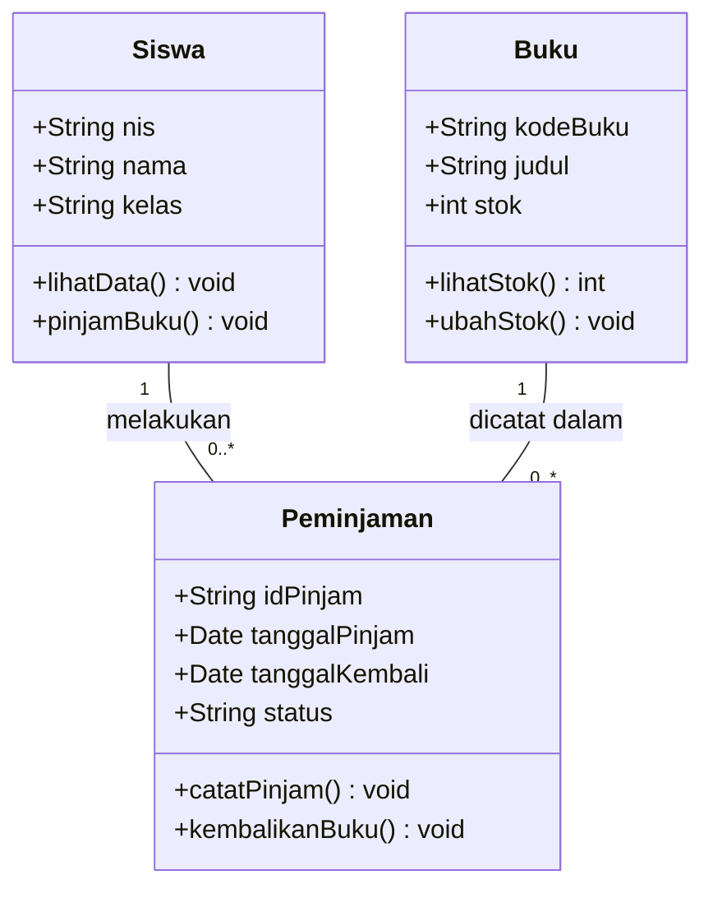

# Studi Kasus: Membuat Class Diagram Sistem Perpustakaan Sekolah

## Deskripsi Studi Kasus

Sebuah SMK ingin membuat aplikasi perpustakaan sederhana untuk membantu petugas mengelola data buku dan peminjaman buku oleh siswa.

Selama ini, proses peminjaman masih dicatat menggunakan buku tulis. Akibatnya, petugas sering kesulitan mengetahui siapa yang sedang meminjam buku dan kapan buku tersebut harus dikembalikan.

Untuk mengatasi masalah tersebut, sekolah berencana membuat **Sistem Perpustakaan Sekolah**.

Sebelum aplikasi dikembangkan, siswa diminta membuat **Class Diagram** untuk menggambarkan struktur kelas, atribut, method, dan hubungan antarkelas.

## A. Ketentuan Sistem

1. Setiap siswa memiliki NIS, nama, dan kelas.
2. Setiap buku memiliki kode buku, judul, penulis, dan stok.
3. Siswa dapat meminjam lebih dari satu buku.
4. Setiap transaksi peminjaman mencatat tanggal pinjam dan tanggal kembali.
5. Petugas dapat mencatat peminjaman dan pengembalian buku.
6. Stok buku akan berkurang ketika dipinjam dan bertambah ketika dikembalikan.

## B. Tugas Siswa

Berdasarkan studi kasus tersebut, buatlah sebuah **UML Class Diagram** dengan ketentuan:

1. Tentukan kelas-kelas yang dibutuhkan dalam sistem.
2. Tentukan minimal tiga atribut untuk setiap kelas.
3. Tentukan minimal dua method untuk setiap kelas.
4. Tentukan tipe data setiap atribut dan method jika diperlukan.
5. Tentukan hubungan (*relationship*) antarkelas.
6. Tambahkan *multiplicity* untuk menunjukkan jumlah hubungan antarobjek.

## C. Contoh Penyelesaian

### 1. Identifikasi Class

| Nama Class | Fungsi |
|---|---|
| `Siswa` | Menyimpan informasi siswa yang meminjam buku |
| `Buku` | Menyimpan informasi buku yang tersedia |
| `Peminjaman` | Mencatat transaksi peminjaman dan pengembalian |

### 2. Class Diagram

### 3. Penjelasan Hubungan

- **Siswa — Peminjaman:** Satu siswa dapat memiliki banyak transaksi peminjaman, tetapi satu transaksi hanya dimiliki oleh satu siswa.
- **Buku — Peminjaman:** Satu buku dapat tercatat dalam banyak transaksi peminjaman pada waktu berbeda, tetapi satu transaksi hanya mencatat satu buku.

> **Catatan:** Diagram di atas merupakan contoh sederhana. Atribut `penulis` dapat ditambahkan ke kelas `Buku` untuk melengkapi ketentuan sistem. Dalam pengembangan lebih lanjut, kelas `Petugas` juga dapat ditambahkan.

## D. Latihan Mandiri

### Studi Kasus: Sistem Kantin Sekolah

Kantin sekolah ingin membuat aplikasi sederhana untuk mencatat transaksi pembelian makanan dan minuman.

Setiap makanan memiliki kode, nama, dan harga. Siswa dapat membeli beberapa jenis makanan dalam satu transaksi. Setiap transaksi mencatat tanggal pembelian dan total pembayaran.

**Tugas:**

1. Tentukan class yang diperlukan.
2. Buat minimal tiga atribut pada setiap class.
3. Buat minimal dua method pada setiap class.
4. Tentukan hubungan antarkelas.
5. Gambarkan Class Diagram beserta multiplicity-nya.
