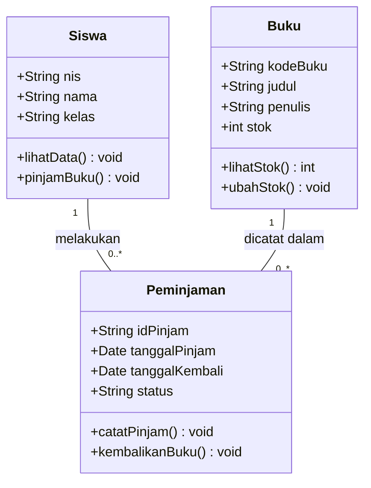

# Studi Kasus: Membuat Class Diagram

## Studi Kasus: Sistem Perpustakaan Sekolah

### A. Deskripsi Studi Kasus

Sebuah SMK ingin membuat aplikasi perpustakaan sederhana untuk membantu petugas mengelola data buku dan peminjaman buku oleh siswa.

Selama ini, proses peminjaman masih dicatat menggunakan buku tulis. Akibatnya, petugas sering kesulitan mengetahui siapa yang sedang meminjam buku dan kapan buku tersebut harus dikembalikan.

Untuk mengatasi masalah tersebut, sekolah berencana membuat **Sistem Perpustakaan Sekolah**.

Sebelum aplikasi dikembangkan, siswa diminta membuat **Class Diagram** untuk menggambarkan struktur kelas, atribut, method, dan hubungan antarkelas.

### B. Ketentuan Sistem

1. Setiap siswa memiliki NIS, nama, dan kelas.
2. Setiap buku memiliki kode buku, judul, penulis, dan stok.
3. Siswa dapat meminjam lebih dari satu buku.
4. Setiap transaksi peminjaman mencatat tanggal pinjam dan tanggal kembali.
5. Petugas dapat mencatat peminjaman dan pengembalian buku.
6. Stok buku akan berkurang ketika dipinjam dan bertambah ketika dikembalikan.

### C. Tugas Siswa

Berdasarkan studi kasus tersebut, buatlah sebuah **UML Class Diagram** dengan ketentuan:

1. Tentukan class yang dibutuhkan dalam sistem.
2. Tentukan minimal tiga atribut untuk setiap class.
3. Tentukan minimal dua method untuk setiap class.
4. Tentukan tipe data setiap atribut dan method.
5. Tentukan hubungan (*relationship*) antarkelas.
6. Tambahkan *multiplicity* untuk menunjukkan jumlah hubungan antarobjek.

### D. Contoh Penyelesaian

#### 1. Identifikasi Class

| Nama Class | Fungsi |
|---|---|
| Siswa | Menyimpan informasi siswa yang meminjam buku |
| Buku | Menyimpan informasi buku yang tersedia |
| Peminjaman | Mencatat transaksi peminjaman dan pengembalian |

#### 2. Class Diagram

#### 3. Penjelasan Hubungan Antarkelas

**Siswa — Peminjaman**

Satu siswa dapat melakukan banyak transaksi peminjaman. Namun, setiap transaksi peminjaman hanya dilakukan oleh satu siswa.

**Buku — Peminjaman**

Satu buku dapat tercatat dalam banyak transaksi peminjaman pada waktu yang berbeda. Namun, setiap transaksi peminjaman hanya mencatat satu buku.

---

## E. Latihan Mandiri 1 — Tingkat Dasar

### Studi Kasus: Sistem Kantin Sekolah

#### Deskripsi Studi Kasus

Sebuah kantin sekolah ingin membuat aplikasi sederhana untuk mencatat transaksi pembelian makanan dan minuman.

Setiap makanan memiliki kode makanan, nama makanan, harga, dan stok. Siswa yang membeli makanan harus memberikan informasi berupa NIS, nama, dan kelas.

Siswa dapat membeli beberapa jenis makanan dalam satu transaksi. Setiap transaksi mencatat tanggal pembelian dan total pembayaran.

Aplikasi harus dapat menghitung total harga makanan yang dibeli berdasarkan jumlah dan harga masing-masing makanan.

#### Ketentuan Sistem

1. Setiap siswa memiliki NIS, nama, dan kelas.
2. Setiap makanan memiliki kode, nama, harga, dan stok.
3. Satu siswa dapat melakukan banyak transaksi pembelian.
4. Satu transaksi dapat berisi beberapa jenis makanan.
5. Setiap transaksi mencatat tanggal pembelian.
6. Sistem dapat menghitung total pembayaran berdasarkan makanan yang dibeli.

#### Tugas Siswa

Berdasarkan studi kasus tersebut, buatlah **UML Class Diagram** dengan ketentuan:

1. Identifikasi class yang diperlukan dalam sistem.
2. Tentukan atribut setiap class beserta tipe datanya.
3. Tentukan minimal dua method pada setiap class.
4. Tentukan hubungan antarkelas yang sesuai.
5. Tambahkan multiplicity pada setiap hubungan.
6. Gambarkan Class Diagram secara lengkap.

---

## F. Latihan Mandiri 2 — Tingkat Menengah

### Studi Kasus: Sistem Penyewaan Lapangan Futsal

#### Deskripsi Studi Kasus

Sebuah tempat penyewaan lapangan futsal ingin mengembangkan aplikasi untuk mengelola pemesanan lapangan, data pelanggan, dan pembayaran.

Tempat tersebut memiliki beberapa lapangan dengan jenis dan harga sewa yang berbeda. Setiap lapangan mempunyai kode lapangan, nama lapangan, jenis lapangan, dan harga sewa per jam.

Pelanggan yang ingin menyewa lapangan harus melakukan pendaftaran terlebih dahulu dengan memberikan nama, nomor telepon, dan alamat.

Setelah terdaftar, pelanggan dapat melakukan pemesanan dengan memilih lapangan, tanggal bermain, jam mulai, dan durasi penyewaan.

Sistem akan menghitung total biaya berdasarkan durasi penyewaan dan harga lapangan per jam.

Setiap pemesanan memiliki status, yaitu:

- Menunggu Pembayaran
- Dikonfirmasi
- Selesai
- Dibatalkan

Pelanggan dapat melakukan pembayaran untuk pemesanan yang dibuat. Pembayaran mencatat tanggal pembayaran, jumlah pembayaran, metode pembayaran, dan status pembayaran.

Sistem juga harus memastikan bahwa lapangan tidak dapat dipesan oleh dua pelanggan pada tanggal dan waktu yang bertabrakan.

#### Ketentuan Sistem

1. Satu pelanggan dapat melakukan banyak pemesanan.
2. Satu pemesanan hanya dilakukan oleh satu pelanggan.
3. Satu lapangan dapat memiliki banyak pemesanan pada waktu berbeda.
4. Satu pemesanan hanya menggunakan satu lapangan.
5. Setiap pemesanan dapat memiliki satu pembayaran.
6. Pelanggan dapat membatalkan pemesanan selama belum dikonfirmasi.
7. Sistem menghitung total biaya penyewaan secara otomatis.
8. Sistem harus memeriksa ketersediaan lapangan sebelum menerima pemesanan.
9. Setiap pemesanan memiliki status yang menunjukkan kondisi pemesanan.
10. Setiap pembayaran memiliki metode dan status pembayaran.

#### Tugas Siswa

Berdasarkan studi kasus tersebut, buatlah **UML Class Diagram** dengan ketentuan:

1. Identifikasi minimal empat class yang diperlukan.
2. Tentukan minimal empat atribut untuk setiap class beserta tipe datanya.
3. Tentukan minimal tiga method yang sesuai dengan tanggung jawab setiap class.
4. Gambarkan hubungan antarkelas menggunakan association yang sesuai.
5. Tambahkan multiplicity seperti `1`, `0..1`, dan `0..*` pada setiap hubungan.
6. Tentukan class dan method yang bertanggung jawab menghitung total biaya penyewaan.
7. Tentukan class dan method yang bertanggung jawab memeriksa ketersediaan lapangan.

#### Tantangan Tambahan: Fitur Diskon Member

Pemilik tempat futsal ingin memberikan keuntungan bagi pelanggan yang terdaftar sebagai member.

Pelanggan yang menjadi member akan mendapatkan **diskon 10% dari total biaya penyewaan**.

Ketentuan tambahan:

1. Pelanggan dibedakan menjadi pelanggan biasa dan member.
2. Pelanggan biasa membayar harga sewa normal.
3. Member mendapatkan diskon 10% dari total harga sewa.
4. Sistem harus dapat menghitung total pembayaran setelah diskon.
5. Informasi status keanggotaan pelanggan harus tersimpan dalam sistem.

**Tugas Tambahan:**

1. Tentukan atribut yang diperlukan untuk menyimpan status keanggotaan.
2. Tentukan method yang digunakan untuk menghitung diskon.
3. Tentukan class yang bertanggung jawab menghitung total pembayaran setelah diskon.
4. Perbarui Class Diagram agar mendukung fitur member.
5. Jelaskan perubahan yang dilakukan pada Class Diagram sebelumnya.

---

## G. Petunjuk Pengerjaan

Sebelum menggambar Class Diagram, lakukan langkah-langkah berikut:

1. **Baca studi kasus dengan teliti.** Pahami kebutuhan dan aturan sistem yang akan dikembangkan.
2. **Identifikasi class.** Cari objek utama yang memiliki data dan perilaku.
3. **Tentukan atribut.** Tentukan informasi yang perlu disimpan oleh setiap class.
4. **Tentukan method.** Tentukan tindakan atau fungsi yang dapat dilakukan setiap class.
5. **Tentukan relationship.** Identifikasi bagaimana setiap class saling berhubungan.
6. **Tentukan multiplicity.** Perhatikan jumlah objek yang dapat berhubungan dengan objek lainnya.
7. **Gambarkan Class Diagram.** Susun seluruh class dan hubungannya menggunakan notasi UML.
